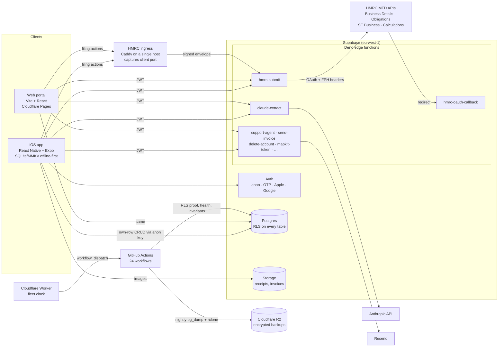

# SoleTax — engineering showcase

SoleTax is a Making Tax Digital (MTD) compliance app for UK sole traders: automatic
mileage tracking, AI receipt capture, jobs and invoicing, a running tax estimate, and
direct quarterly filing to HMRC. It is an iOS app (React Native / Expo, on the App Store
since September 2026) with a web portal, both backed by Supabase (Postgres, Auth,
Storage, Deno edge functions) on Cloudflare. It is built and run by one person. This
repository is a scrubbed, read-only extract of the private production repo so that an
engineer can read the parts that matter — the HMRC filing server, the tax engine and its
test suites, the CI/CD workflows and the security model — without the production repo
being made public. Everything here is real code from production; what was removed, and
why, is listed at the end.

**Jump to:** [Architecture](#architecture) · [HMRC integration](#hmrc-integration) ·
[CI/CD](#cicd) · [Security model](#security-model) · [Testing and validation](#testing-and-validation) ·
[Observability](#observability-and-debugging-a-failed-submission) · [Known gaps](#known-gaps-and-what-i-would-do-next) ·
[How this was built](#how-this-was-built) · [What is in this repo](#what-is-in-this-repo-and-what-is-not)

```bash
npm ci
npm run check      # tsc + eslint + the tax engine and HMRC server rule suites (~1,000 assertions)
```

---

## Architecture



How the pieces connect:

- **Clients talk to Postgres directly** for everything that is their own data. Row-level
  security is the authorisation layer; the anon/publishable key ships in the bundle by
  design and opens only the doors RLS allows.
- **Anything that needs a secret goes through an edge function**: the Anthropic key, the
  HMRC OAuth client secrets and tokens, the email provider, the MapKit signing key. The
  `service_role` key exists only inside those functions and a CI check fails if it ever
  appears in a client bundle.
- **HMRC is never called from a client.** `hmrc-submit` holds the OAuth client secrets,
  the user's encrypted HMRC tokens and National Insurance number, assembles HMRC's
  fraud-prevention headers and writes one audit row per attempt. Filing requests are
  dialled through a small Caddy host rather than the Supabase hostname so the client's
  public TCP port can be observed (HMRC requires it; see below).
- **Operations run from GitHub Actions**: deploys, nightly backups, health probes, data
  invariants, a weekly security pass. A Cloudflare Worker dispatches the scheduled ones
  on time because GitHub cron is best-effort.

---

## HMRC integration

Source: `supabase/functions/hmrc-submit/index.ts`, `supabase/functions/hmrc-oauth-callback/index.ts`,
`supabase/functions/_shared/hmrc*.ts`. Rules pinned by `scripts/test-hmrc-server.ts` (120 checks).

### OAuth flow

```
app/portal ──connect──▶ hmrc-submit mints state = HMAC-SHA256(uid, env, surface, exp 10 min)
                       returns HMRC authorize URL
user ──authorises on HMRC──▶ HMRC redirects to hmrc-oauth-callback?code&state
hmrc-oauth-callback: verify HMAC → exchange code with client secret (same env the state was
                     minted for) → AES-256-GCM encrypt access+refresh tokens → upsert
                     hmrc_connections(user_id, environment, …) → 302 back to app deep link
                     or portal /tax
```

- The callback is deployed without JWT verification (HMRC's browser redirect carries no
  Supabase session), so the signed `state` is the whole security model: unforgeable
  without `HMRC_TOKEN_KEY`, time-boxed, and it binds the resulting tokens to exactly one
  user id, one environment and one return surface.
- Every other action is a JWT-verified POST to `hmrc-submit` with an `action` field:
  `status`, `connect`, `disconnect`, `saveNino`, `businesses`, `selectBusiness`,
  `obligations`, `submit`, `calculate`, plus two sandbox-only actions (`validate`,
  `createTestBusiness`) that the server refuses in production.

### Token and identity handling

- Access and refresh tokens and the National Insurance number are stored encrypted
  (AES-256-GCM, random IV per value) in `hmrc_connections`. The table has RLS enabled
  with **no policies** and grants only to `service_role`: no client can read a row even
  with a valid session. Decryption happens only inside the function.
- HMRC refresh tokens are single-use, so refreshes are single-flight per account: a
  claim is written to `hmrc_connections.refreshing_at`; concurrent callers wait for the
  winner's token instead of racing.
- Environment is resolved per account (`hmrcEnv.ts`): production once the global
  switch reads `"true"`, sandbox for accounts marked in `hmrc_account_modes`. A stored
  connection must match its account's environment or the user is asked to reconnect. A
  missing production credential refuses the call rather than falling back to sandbox.

### Retry policy

`hmrcFetch.ts` retries **only** on HTTP 429, honouring HMRC's `Retry-After` when sent and
otherwise doubling with jitter from 400 ms, capped at 5 s per wait, three retries, 15 s
per-attempt timeout. Nothing else is retried: a submission that reached HMRC must never
be sent twice by a blind retry. HMRC's error codes map to user-facing copy in
`hmrcErrors.ts`; codes that indicate a fault on our side raise a server event rather
than a user message. Sends are additionally rate-limited per account (12/hour, 40/day)
and gated by a per-surface kill switch (`hmrc_filing_switch`, off by default; paused
wins over everything).

### Fraud-prevention headers and the Caddy ingress

HMRC requires a fixed set of `Gov-Client-*` / `Gov-Vendor-*` headers on every call and
evaluates them before granting production credentials. `hmrcFph.ts` builds two sets:
`MOBILE_APP_VIA_SERVER` for the app (the exact set that passed HMRC's evaluation on
29 Sep 2026, pinned byte-for-byte by the tests) and `WEB_APP_VIA_SERVER` for the portal.

One header, `Gov-Client-Public-Port`, can only be observed where TLS terminates with
nothing in front of it. Supabase's edge runtime sits behind Cloudflare and cannot see it,
and HMRC declined the omission. So filing calls are dialled to a small host running
Caddy which terminates TLS, reads the TCP peer address and port, and reverse-proxies to
the unchanged edge function with a signed `X-SoleTax-*` envelope (client IP, port,
receipt time, the ingress's own address). `hmrc-submit` verifies the envelope with a
timing-safe compare and a check that the request really came from the ingress's
addresses, and refuses HMRC-calling actions with 428 if the envelope is missing. Nothing
else moves: secrets, tokens and the audit table stay in the function.

---

## CI/CD

Production has 24 GitHub Actions workflows. Eight are included under
`.github/workflows/production/` as reference copies; `CI-CD.md` walks the portal pipeline
step by step. All actions are SHA-pinned and Dependabot keeps the pins current.

| When | What runs |
|---|---|
| **Every push and PR** | `secrets.yml`: gitleaks over the full history, no path filter (docs commits are exactly where a pasted credential lands). A hit emails an alert the same minute. |
| **Code push / PR** (path-filtered, default is *run*; only known-inert paths opt out) | `security.yml`: npm-audit against a hand-justified baseline, both lockfiles, fails on a *new* high/critical only; Semgrep SAST with each excluded rule carrying its rationale. `compliance-check.yml`: tax-rates and SA103F review-date alarm, citation-key check, `tsc --noEmit`, lint, `npm run test:tax` (60 scripts). |
| **Merge to main** | `portal-deploy.yml` (paths `portal/**`): build → design-parity census ratchet → CORS keystone → Playwright gate over the built bundle with an anonymous session → Cloudflare Pages. `website-deploy.yml` likewise for the marketing site. `rls-per-migration.yml` (paths `supabase/migrations/**`): re-prove tenant isolation against production with anon-key-only clients on the exact commit that changed the policy surface. |
| **Nightly** | `backup.yml`: pg_dump as a read-only role + rclone of both storage buckets + `git bundle --all`, age-encrypted to a public key whose private half never enters CI, to an EU R2 bucket, 35-day retention, success pings an external dead-man's switch. `edge-health.yml`: probe every edge function; SQL for failed HMRC submissions in the last 25 h. `data-invariants.yml`: FK orphans, duplicates, future sync stamps, negatives. Red → GitHub issue, deduped. |
| **Weekly (Monday)** | `security.yml` full pass: the above plus the live 24-check RLS isolation test and a "fleet report" that commits the results as findings. `compliance-check.yml` date alarm backstop so a quiet no-push stretch cannot silence it. |

Not automated, deliberately or not yet: iOS builds are archived locally and attached to
TestFlight/App Review through scripts against the App Store Connect API; edge functions
and migrations are deployed by hand with the Supabase CLI. Both are in the gaps list.

A design choice worth noting: the Supabase Management API token and the backup private
key are kept out of GitHub Actions on purpose. Everything CI does against production it
does with the public anon key or a dedicated read-only database role. The cost is that
the penetration-test script and the restore drill run from a workstation.

---

## Security model

Documents: `docs/security/threat_model.md`, `security_plan.md`, `runbooks.md`
(redacted), `SECURITY.md`. Enforcement: `security/surface.ts`,
`scripts/test-security-coverage.ts`, `scripts/test-rls-isolation.mjs`.

- **RLS on every table.** Own-row policies on user data; a default-deny shape (RLS on,
  no policies, `service_role` grant only) on anything holding secrets or audit data
  (`hmrc_connections`, `extract_turns`, `server_events`). Storage buckets carry
  owner-only policies. Clients cannot call privileged RPCs (`EXECUTE` revoked).
- **The RLS proof is empirical, not asserted.** `test-rls-isolation.mjs` signs in two
  fresh anonymous users with only the anon key — exactly what an attacker has — and has
  B attempt to read, update, delete, spoof-insert and RPC-tunnel into A's rows and
  storage objects. 24 checks. It runs weekly, on every migration merge, and before any
  policy change ships.
- **The surface gate.** `security/surface.ts` is a single declarative inventory of every
  attack surface: edge functions, workflows, Worker routes, wired secret references,
  outbound hosts, database grants. `test-security-coverage.ts` discovers the real surface
  from the filesystem and fails CI when an element is claimed by no probe, no dated risk
  acceptance and no not-applicable ruling. New surface cannot ship un-triaged. Its stated
  limit: it sees repo-expressed surface only, not dashboard drift.
- **Secrets handling.** `.env.local` is gitignored and has never been tracked. Edge
  function secrets live in Supabase; CI secrets in GitHub; admin tokens on one machine.
  gitleaks runs on every push with an allowlist whose every entry carries a
  public-by-design rationale. `test-no-service-role-in-bundle.mjs` runs in CI.
- **Data minimisation in logs.** `server_events` records status and counts only — never
  receipt text, images, chat or record bodies — with a 90-day retention job.
- **Backups.** Nightly, encrypted to a key CI cannot decrypt with, EU-resident,
  externally monitored for absence, and restore-rehearsed end to end (row counts,
  policies, indexes, triggers and per-table checksums compared to production).
- **Consent.** Nothing reaches the Anthropic API without an in-app permission ask that
  names the recipient; a hard backstop inside the extraction path enforces it on every
  route, and 29 CI checks pin the invariant (added after an App Review rejection).
- **Disclosure.** `SECURITY.md` and a published `security.txt`.

---

## Testing and validation

There is no Jest or Vitest. `npm run test:tax` in production is a chain of 60 standalone
`tsx` scripts, each a self-contained assertion suite that exits non-zero on failure. The
style is deliberate: pure modules with injectable dependencies (`fetchImpl`, `sleep`,
`random`) and worked examples from primary sources rather than mocks of our own code.
Seven of those suites run in this repo's CI; the rest need the private register or live
services.

**Tax engine** (`src/tax/`, `scripts/test-tax-*.ts`):
- 219 worked-example checks against HMRC's published figures and worked examples:
  income tax by nation, Class 2/4 NIC, HICBC, dividends and savings, student loans,
  payments on account.
- A 182-check differential harness: engine vs an independently written reference
  implementation across anchors, invariants and band boundaries.
- A fuzz suite: 50,000 random full-bill cases, engine == reference, fixed seed.
- 286 selector checks (which receipts and trips enter the estimate and why), 54 date
  checks, 186 rule-card checks (every number on screen traces to a cited rule).
- `scripts/golden-set/`: scenarios entered by hand into an HMRC-recognised Self
  Assessment package and compared figure-by-figure (`RESULTS.md`).
- An external review by a qualified accountant, who returned a harness CSV of their
  own figures. One finding (VAT-inclusive bookkeeping) led to a feature being dropped.

**HMRC filing server** (`scripts/test-hmrc-server.ts`, 120 checks): environment
switching never falls back silently; NINO shape and masking; every HMRC error code maps
to copy; 429 back-off honours `Retry-After`; the kill switch is off by default and
paused wins; cumulative periods and quarter ends per the SE Business 5.0 spec; the
mobile FPH header set is exactly the one HMRC evaluated and the web set is never mixed
with it.

**Receipt extraction** (production only; `scripts/receipt-eval.ts`): every fixture
receipt runs through the same prompt + parse path the app ships, against the real edge
function and model pin, scored field by field — amount, date and SA103F category exact,
merchant fuzzy. Gate: ≥95% all-three and p95 < 3 s. The report prints its own caveat
that rendered fixtures are not crumpled photos.

**Isolation and deploy proofs**: the 24 live RLS checks above; a Playwright gate over
the built portal that seeds own-row data with an anonymous session and pins every route
with zero console errors before Cloudflare Pages receives it.

---

## Observability, and debugging a failed submission

What exists: Sentry on the app (dSYMs uploaded post-archive; dev sessions suppressed),
Mixpanel for product events, Supabase function logs, the `server_events` audit table,
and the two nightly sweeps that open GitHub issues on red. `edge-health.yml` specifically
queries `hmrc_submissions` for failures in the last 25 hours because a silently failed
filing is the worst outcome in the product.

Debugging a failed submission, in order:

1. **`hmrc_submissions`** — one row per attempt: user, environment, surface, business id,
   tax year, period, the exact payload sent, HTTP status, HMRC's `X-CorrelationId`, the
   raw error body, and the mapped outcome kind/code. This usually answers it.
2. **`server_events`** for that user and `source = 'hmrc-submit'` — the status-and-counts
   trail around the attempt (refresh, switch evaluation, rate-limit admission, send).
3. **Supabase function logs** for the invocation, filtered by the correlation id.
4. If the error is HMRC-side, `hmrcErrors.ts` says what the user saw and whether it was
   a turnaway (not eligible), a retryable busy, or a format/rule fault that is ours.
5. If it is systemic, set `hmrc_filing_switch.paused = true` for the affected surface
   (takes effect on the next request), fix, re-prove with `test-hmrc-server.ts`, unpause.

What is missing is in the next section.

---

## Known gaps, and what I would do next

Ranked by what a "production-grade, CI/CD, security-first" reviewer would flag first.
All of these are already recorded in the production docs; none is a surprise.

1. **Edge functions and migrations deploy by hand.** Next: a `supabase-deploy.yml` on
   `supabase/**` using a project-scoped CLI token, ordered after `rls-per-migration`.
2. **No framework test runner, no coverage number, no UI tests.** Next: wrap the
   existing scripts in Vitest (they are already pure with injectable deps), publish
   coverage, add component tests on the filing and consent screens.
3. **No staging environment in CI.** The "staging ritual" restores a production copy
   locally. Next: Supabase branching on PRs, and point the Playwright gate at the branch.
4. **Observability is three consoles and a nightly SQL query.** Next: pipe function logs
   to a sink with an error-rate alert on `hmrc-submit`, and a Sentry alert rule.
5. **Explicit RLS policies are thin relative to tables with RLS enabled.** The
   default-deny pattern is sound, but a reviewer wants a policy-per-table matrix. Next:
   generate it from the migrations and commit it next to `surface.ts`.
6. **iOS release is scripted but not a pipeline.** Next: Fastlane or EAS Build on a tag.
7. **The database runs on Supabase's entry tier with DIY backups.** Mitigated and
   restore-proven; the upgrade is a capacity decision, not a safety one.

---

## How this was built

I am not a professional software engineer by trade. I design the system — the data
model, the trust boundaries, the HMRC contract, what must be true for a filing to be
safe to send — and build it with Claude Code, session by session, with every decision
written down before the code exists. The thing I am most careful about is validation,
because a fluent wrong answer looks the same as a right one:

- **Primary sources, not memory.** No tax rule is implemented from recollection or a blog.
  Every figure cites a verbatim HMRC or gov.uk document in a register, and CI fails when a
  source passes its review date.
- **Tests before trust.** Every rule in the filing server was extracted into a pure module
  and pinned before it was wired. The tax engine has an independent reference
  implementation, a fuzz suite and a golden set from an HMRC-recognised package.
- **Evals for the model-shaped parts.** Receipt extraction is scored against truth-by-
  construction fixtures with a numeric bar; the eval prints its own honesty caveat.
- **Adversarial proof for security.** The RLS test attacks the live database with an
  attacker's credentials. The surface gate assumes I will forget to watch something.
- **External review.** A qualified accountant reviewed the engine and the product; HMRC
  evaluated the fraud-prevention headers; Apple rejected the app three times and each
  rejection became a CI check.

The inline comments in this repo are unusually long because they are the decision log.
They are written for whoever reads the code next, which is usually a model, and
occasionally me.

---

## What is in this repo, and what is not

**Included**
- `.github/workflows/production/` — eight production workflows, identifiers replaced
  with placeholders, SHA pins intact. `.github/workflows/ci.yml` is this repo's own gate.
- `supabase/functions/hmrc-submit/`, `hmrc-oauth-callback/`, `_shared/hmrc*.ts`,
  `cors.ts`, `rateLimit.ts`, `serverEvents.ts`, `ipScope.ts` — the filing server as
  deployed, minus environment values.
- `src/tax/` — the whole engine and its README; `src/receipts/`, `src/income/`,
  `src/lib/`, `src/trips/types.ts` — the types and tables it depends on.
- `scripts/test-tax-*.ts`, `test-rule-cards.ts`, `test-hmrc-server.ts`,
  `test-security-coverage.ts`, `test-rls-isolation.mjs`, `scripts/golden-set/`.
- `security/surface.ts`; `docs/security/` (runbooks in a redacted edition); `SECURITY.md`;
  `.gitleaks.toml`.

**Excluded, and why**
- The app UI, navigation, stores, sync and the portal source — product, not the
  engineering story asked for here.
- `src/tracking/` — the mileage detection model and ~600 KB of transport-network
  indices; commercially sensitive. `src/tracking/gapCredit.ts` is a type stub so
  `trips/types.ts` compiles.
- `claude-extract`, `support-agent` and the other edge functions — prompts and model
  configuration.
- `docs/compliance/` — the verbatim HMRC source register and correspondence.
- The 52 other test scripts, evals and simulators — they import the excluded code or
  call live services.
- Everything operational from the runbooks: credential names and locations, vendor
  account details, dashboard paths, precedents.
- Supabase project refs, hostnames, bucket and Pages project names, email addresses,
  the backup public key, the Sentry DSN, and the names of beta testers and reviewers.

This repo is published for review. The code is not licensed for reuse.
